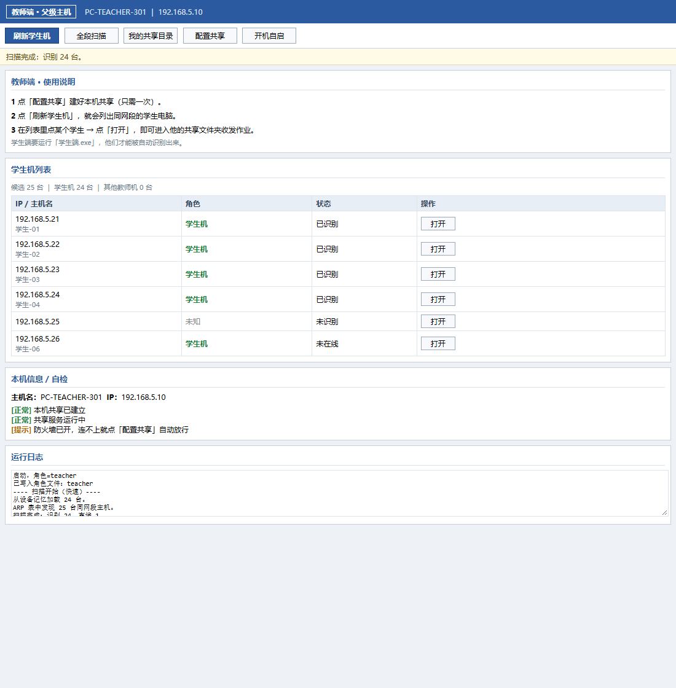
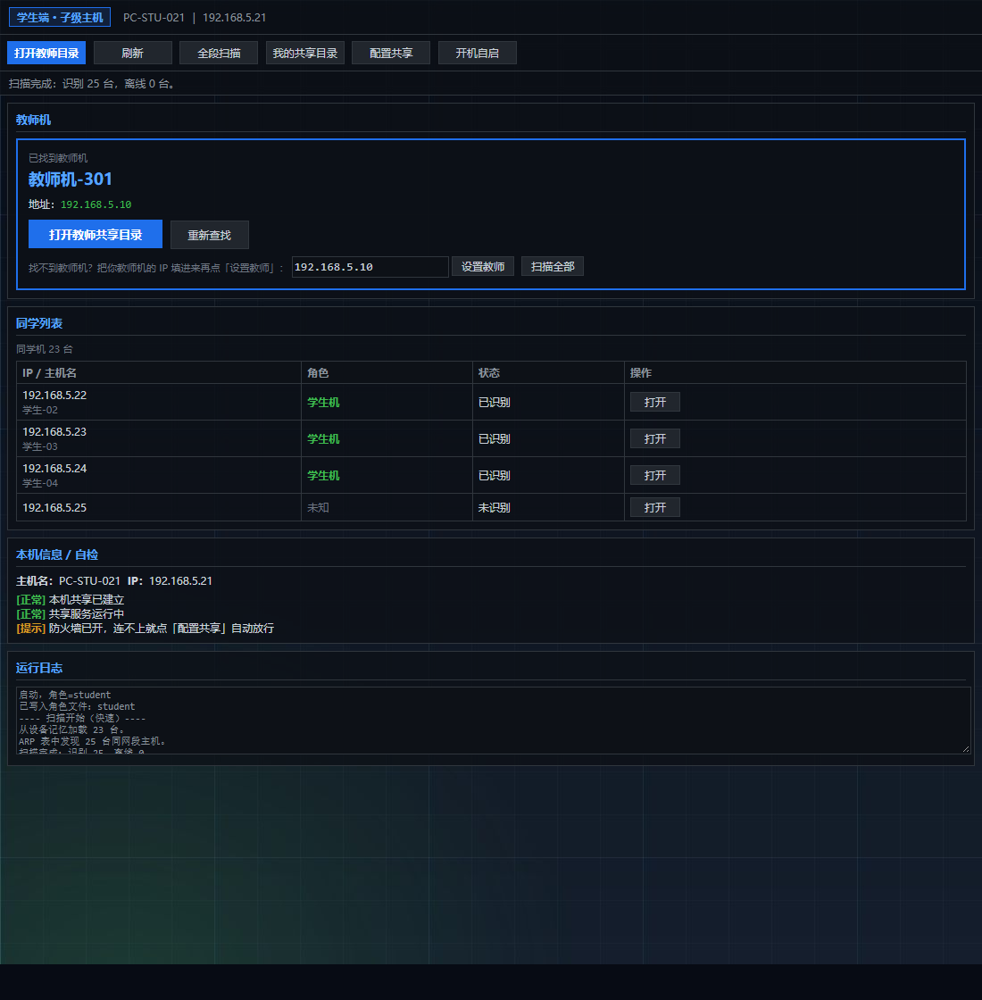

# lanpass · 局域通

> 在「网上邻居看不到人」的机房里，让 Windows 7 / 10 / 11 互相传文件。

一个零依赖的局域网文件共享工具，专治机房场景下的跨版本互访失败。不需要服务器、不需要安装任何运行库、不需要联网。

---

## 为什么做这个

Windows 机房有个很常见的场景：几十台电脑，同一台交换机，同一个网段，但「网上邻居」里互相看不见。

原因有两层，第二层才是真正的病根。

### 表层原因：家庭组没了

| 版本 | 家庭组状态 |
|------|-----------|
| Windows 7 | 引入 |
| Windows 8.1 | 仍在 |
| Windows 10 1803（2018） | **被微软彻底移除** |

Win7 和 Win10/11 之间根本没有共同的家庭组机制，这是「看不到」的第一层原因。

### 深层原因：SMB 来宾认证被默认关闭

即使绕过家庭组、直接用 IP 访问共享，Win10/11 仍然会报错：

> 你组织的安全策略阻止未经身份验证的来宾访问

这是从 **Windows 10 1709** 开始的安全加固：

| 注册表项 | 默认值 | 后果 |
|---------|--------|------|
| `AllowInsecureGuestAuth` | `0`（未设置） | 拒绝所有匿名 SMB 访问 |
| `LimitBlankPasswordUse` | `1` | 空密码账户不能远程登录 |

**只解决家庭组没有用，卡在 SMB 认证这一层。** 这是lanpass要解决的核心问题。

---

## 核心特性

| 特性 | 说明 |
|------|------|
| **零依赖** | 只用系统自带的 `mshta.exe` / `cmd.exe` / `net.exe` / `ping.exe` / `arp.exe`。不需要 .NET（任何版本）、VC++ 运行库、Java、Python、Node、Rust、Go |
| **不依赖网络发现** | 网络发现、家庭组、Computer Browser、SSDP、DNS 全部失效也能用 |
| **跨版本互通** | Win7 ↔ Win10 ↔ Win11，双向访问 |
| **双端设计** | 教师端（管理全班）+ 学生端（一键交作业） |
| **自动修复认证** | 一键写入 4 项注册表，解决「安全策略阻止来宾访问」 |
| **主动发现** | ARP 表 + 全段 ping 扫描，不依赖任何系统服务 |
| **设备记忆** | 扫到的机器存本地，下次开机秒出列表 |
| **低开销** | 内存 ~34 MB，空闲 CPU 0%，无定时器轮询，奔腾机器可跑 |

---

## 界面

**教师端**（父级主机，浅色主题）



**学生端**（子级主机，深色主题）



---

## 快速开始

### 方式一：EXE（双击即用）

1. 把整个目录拷到机房电脑
2. 教师机双击 `教师端.exe`，学生机双击 `学生端.exe`
3. 点「配置共享」，UAC 弹窗点「是」
4. 教师端点「刷新学生机」，列表空就点「全段扫描」
5. 点学生那行的「打开」，进入共享目录收作业

### 方式二：绿色版（免安装）

打开绿色版文件夹，双击 `启动教师端.bat` 或 `启动学生端.bat`。

功能完全一样，区别是不写安装注册表、不释放文件到临时目录，杀软误报概率更低。

---

## 技术原理

### 1. 发现：不碰任何系统服务

```
ARP 表（TCP/IP 二层，与 Windows 服务无关）
    ↓ ARP 为空时
全段 ping 扫描（254 个地址，分批 32 个并行，约 4 秒）
    ↓ 填充 ARP 表
读对方共享里的标记文件 .lanshare.ini
    ↓
识别角色（teacher / student）
```

关键点：**ping 的目的是填充 ARP 表，不是等 ICMP 回应**。即使对方防火墙禁 ping，只要在线，ARP 层仍会记录它的 MAC。

### 2. 互通：四项注册表修复

配置共享时自动执行：

```
AllowInsecureGuestAuth = 1     允许来宾访问
LimitBlankPasswordUse  = 0     允许空密码账户远程访问
RestrictNullSessAccess = 0     允许匿名会话访问共享
net user guest /active:yes     启用 Guest 账户
```

### 3. 角色识别：一个文本文件

每台机器在共享目录写 `.lanshare.ini`：

```ini
ROLE=teacher
NAME=教师机-301
IP=192.168.5.10
```

对方读到就知道角色。纯文件方案，不需要服务器、数据库或广播协议。

### 4. 界面：HTA + JScript

用 Windows 自带的 `mshta.exe` 渲染 HTA 界面，IE8 引擎兼容模式。所有代码是明文 HTML + JScript，可直接审查。

---

## 文件结构

```
.
├── app.hta              主程序（双端共用，靠启动参数区分角色）
├── 教师端.bat            教师端启动器
├── 学生端.bat            学生端启动器
├── setup-share.bat      一键配置共享 + 跨版本修复
├── autostart.bat        开机自启设置
├── install.bat          EXE 安装逻辑
├── blk-guard.bat        防装拦截（可选，见下文）
├── blk-guard-undo.bat   撤销防装拦截
├── bg-student.jpg       学生端背景图
├── panel-dark.png       学生端半透明纹理
├── build/               IExpress 打包配置
└── docs/
    ├── QRA.txt          常见问题 27 条
    ├── SECURITY.md      给管理员的安全说明
    └── screenshots/     界面截图
```

---

## 性能实测

在 Intel 奔腾级别 + DDR3 8GB 的机房机器上：

| 指标 | 实测值 |
|------|--------|
| 内存占用 | 34 MB |
| 空闲 CPU | 0% |
| 启动 CPU | 0.2 秒 |
| 快速刷新 | 约 1 秒（读设备记忆 + ARP 表） |
| 全段扫描 | 约 4 秒（254 个地址） |

没有定时器轮询，不后台跑任何东西，启动完成后完全静止。

---

## 常见问题

完整 27 条见 [docs/QRA.txt](docs/QRA.txt)。几个高频的：

**Q：Win10 打不开 Win7 的共享，报「安全策略阻止来宾访问」？**

就是本文开头说的 `AllowInsecureGuestAuth`。两台机器都点一次「配置共享」，然后重启电脑。

**Q：列表一直是空的？**

点「全段扫描」。还不行就确认：双方 IP 前三位相同、在同一个交换机、都点过「配置共享」。

**Q：机房没有 D 盘？**

用记事本打开 `setup-share.bat` 和 `app.hta`，把 `D:\lan-share` 改成实际存在的路径（两处都要改）。

**Q：杀毒软件报警？**

见下方「关于防装拦截」和 [docs/SECURITY.md](docs/SECURITY.md)。

---

## 关于「防装拦截」功能

`blk-guard.bat` 是一个**可选**功能，作用是在没有安装 360 / 2345 / 金山毒霸的机器上写入拦截规则，防止以后被安装。

**必须说清楚的三件事**：

1. 它只在点「配置共享」时执行一次，不是常驻
2. 检测到本机已有 360 就**完全跳过**，不碰它
3. 运行 `blk-guard-undo.bat` 可一键删除全部规则

**如果你不需要这个功能**：删掉 `blk-guard.bat` 即可，`setup-share.bat` 找不到会自动跳过，其余功能完全不受影响。

**它会显著提高杀软误报率**。写 IFEO 让特定程序无法启动，本身是恶意软件的常见手法，被安全软件重点监控是必然的。用不用自己权衡。

---

## 安全提示

打开来宾访问意味着**同网段的人不需要密码**就能读写共享目录。

这在机房是合理取舍（机房本来就不该用密码拦学生），但请：

- 只在机房内网使用
- 不要把这类共享暴露到公网
- 知道怎么恢复默认设置（见 [docs/SECURITY.md](docs/SECURITY.md)）

---

## 兼容性

| 系统 | 状态 |
|------|------|
| Windows 7 SP1 | 支持（纯系统命令，不依赖 .NET） |
| Windows 8 / 8.1 | 支持 |
| Windows 10 | 支持（实测） |
| Windows 11 | 支持 |
| 32 / 64 位 | 都支持 |

> Win7 上未做实机测试，代码按 IE8 引擎 + 纯系统命令编写，理论上兼容。有真实环境测试反馈欢迎提 Issue。

---

## 已知限制

- 需要 SMB 445 端口可用。如果机房组策略禁用了文件共享服务，本工具也无能为力
- 交换机开启端口隔离（VLAN 隔离）时，任何局域网工具都无法互通
- 全段扫描基于 /24 网段（前三段相同），非 /24 掩码的网段请用手动填 IP

---

## 踩过的坑

lanpass由实际机房需求驱动，经历了多轮实测修正：

- 批处理换行符（LF vs CRLF）导致脚本全部解析失败
- IE8 的 `tbody.innerHTML` 只读限制
- `net view` 在无 Browser 服务时阻塞 30~60 秒
- 读不可达 IP 的 UNC 路径卡 28~31 秒（改为先 ping 预检）
- MSXML2 在 Win7 下的 TLS 1.2 问题
- findstr 不加斜杠 l 参数时，会把特殊字符当正则处理，导致共享名判断全错

这些坑都写在了代码注释和文档里，希望能帮到遇到同类问题的人。

---

## License

MIT
